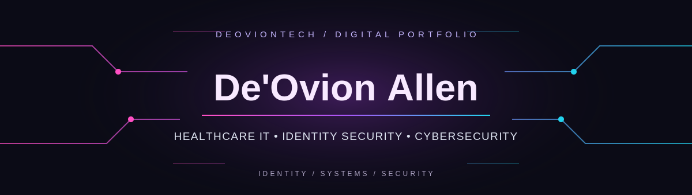

### Healthcare IT · Identity & Access Management · Cybersecurity

Healthcare IT professional supporting enterprise applications, identity and access workflows, and technical operations. Building deeper expertise in cybersecurity, cloud security, and automation through practical technical projects.

---

### ✦ Technical Toolkit

---

### ✦ Featured Work

*Identity security · Network defense · Security automation*

Projects will be linked here as they are completed.

---

